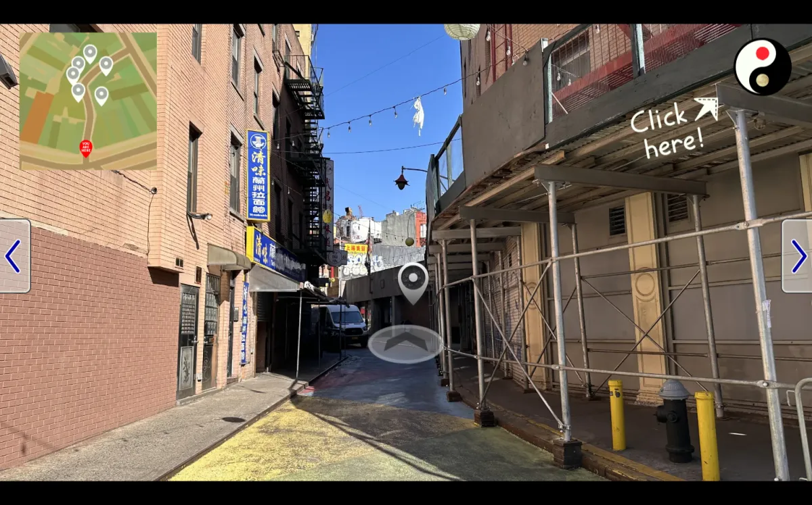

# Doyers Street Tour

A virtual walk down Doyers Street in Manhattan, NYC's very own Chinatown. Move along the street, look around, and get to know important landmarks.

Click on markers to learn more about the corresponding landmark. You'll be able to read about modern bars, restaurants, and attractions by day, and their (not so sunny) history by night.

This was built in 2024 as my final project for an undergraduate illustration course; cleaned up and refactored in 2026.



## Controls

| Action | Mouse | Keyboard |
| --- | --- | --- |
| Look around | Arrow buttons on the sides | ``←``/``→`` or ``A``/``D`` |
| Walk forward/backward | Buttons at the bottom (when facing along the street) | ``↑``/``↓`` or ``W``/``S`` |
| Switch day/night | Clock in the top right | – |
| Learn about a place | Click a marker | – |
| Close a card | Close | Escape |

## How to run

Open `index.html` in a browser, or serve the folder as below:

```sh
python3 -m http.server
```

Then visit http://localhost:8000.

## Project structure

| File | Description |
| --- | --- |
| `index.html` | Page markup for the stage, buttons, minimap, and info card |
| `style.css` | Layout and styling |
| `script.js` | Movement controls, map rendering, audio, and info cards |
| `tour-data.js` | Data for landmarks, links, map markers, and minimap positions |
| `assets/` | Street photos (`bg{A\|P}Location0{1-6}View0{0-7}.webp`, A = day, P = night), UI images, and sounds |

### Making edits

Text, links, and marker positions all live in `tour-data.js`, so changing them doesn't involve touching the code.

To place a marker, set `DEV_MODE = true` at the top of `script.js`, open the view, and click where the marker should go. The console logs `{ x, y }` ready to paste into `MARKERS`.

## License

[MIT](LICENSE.txt).

Prototyped on CodePen.